# GitHub profile dragon

A pixel-art dragon that lives in your GitHub profile README. It is generated by
Node.js once a day, grows with your lifetime commits, changes mood with your
recent activity, gets hungry between commits, and wears your streaks and weekly
achievements.

The generated SVG has **no JavaScript**. Everything moves with embedded CSS
animations, so it renders in a normal `` tag on GitHub, in both light and
dark mode. It respects `prefers-reduced-motion`.

```
.github/workflows/dragon.yml   daily workflow, commits the new SVG
assets/pet.svg                 generated card (README embed)
assets/pet-state.json          tiny state file for streak/reaction changes
src/index.js                   main Node.js entry point
src/github.js                  @octokit/rest + GraphQL data collector
src/pet.js                     growth, mood, hunger, rewards, reactions
src/time.js                    timezone/date helpers
src/streak.js                  current + longest streak calculator
src/templates/stages.js        the five growth-stage templates
src/templates/moods.js         faces and mood effects
src/templates/accessories.js   scarves, crowns, glasses, companions, etc.
src/templates/scenes.js        day/night/sunrise/sunset/beach backgrounds
src/templates/card.js          composes the full 960x480 SVG
scripts/preview.js             renders sample cards for every stage/mood/accessory
```

## 1. Setup from scratch

1. Create a **public** repository named exactly `<your-username>` (this is the
   special GitHub profile repository). Add a `README.md`.
2. Copy this project into that repository, including `.github/`, `src/`,
   `package.json`, `package-lock.json`, and `assets/`.
3. Commit and push.
4. In the repository go to **Settings → Actions → General → Workflow
   permissions** and select **Read and write permissions**. The workflow needs
   this to commit `assets/pet.svg` back to the repo.
5. Optional: add a repository variable named `PET_TIMEZONE` with your IANA
   timezone, for example `Asia/Kolkata` or `America/Los_Angeles`. Without it,
   UTC is used. This controls "today", weekends, the day/night scene, and labels.
6. Go to **Actions → Update profile dragon → Run workflow**. The first run
   creates `assets/pet.svg` and `assets/pet-state.json` and commits them.
7. Paste the embed code below into your profile `README.md`.

The scheduled workflow runs daily at **07:17 UTC**. Change the cron in
`.github/workflows/dragon.yml` if you prefer another time.

### Token

By default the workflow uses the built-in `secrets.GITHUB_TOKEN`, as requested.
That token is an installation token for the repository, so the GitHub APIs only
expose **public** contribution data. The card still shows commits, streaks,
stars, followers, PRs, issues, reviews, and languages from public activity.

If you want private contributions included in lifetime commits and streaks,
create a classic personal access token with `read:user` and add it as a
repository secret named `PET_TOKEN`. The script prefers `PET_TOKEN` when it is
present.

## 2. README embed

Use a relative path so it works on the profile page:

```html
<p align="center">
  
</p>
```

If GitHub's image cache is still showing an old version, add a version query
after a new commit:

```html

```

The SVG itself is self-contained and has a `<title>` and `<desc>` built from the
same stats, so screen readers get the full update.

## 3. Run locally

Requirements: Node 20+.

```bash
npm ci
export GITHUB_TOKEN="$(gh auth token)"   # or a PAT
export PET_USERNAME="your-username"
export PET_TIMEZONE="Asia/Kolkata"       # optional
npm start
```

On Windows PowerShell:

```powershell
$env:GITHUB_TOKEN = (gh auth token)
$env:PET_USERNAME = "your-username"
$env:PET_TIMEZONE = "Asia/Kolkata"
npm start
```

The generated files are `assets/pet.svg` and `assets/pet-state.json`.

Render a gallery of every stage, mood, reward, and accessory:

```bash
npm run preview
```

Preview cards are written to `previews/` (ignored by git).

Run the logic tests (growth thresholds, moods, hunger, streaks, reactions):

```bash
npm test
```

## 4. What is on the card

### Growth stages (lifetime commits)

| Commits | Stage | Visual |
| --- | --- | --- |
| 0–49 | Egg | wobbles, cracks as it nears 50 |
| 50–199 | Hatchling | tiny body, huge eyes, stubby wings |
| 200–599 | Young dragon | small flight loop, first flame puff |
| 600–1499 | Adult dragon | large wings, steady fire breath |
| 1500+ | Elder dragon | golden scales, glowing aura, floating gems |

The egg's crack amount is driven by `totalCommits / 50`; at high counts the egg
shakes harder.

### Mood

Precedence, strongest first:

| Condition | Mood | Visual |
| --- | --- | --- |
| 14+ days since last commit / never | asleep | corner, cobwebs, dust, `zzz` |
| 7+ days | sulking | back turned, drooping wings, ember, "come back!" |
| 3+ days | hungry | roaring, stomach rumble |
| 1+ day | peckish | half-lidded, small rumble |
| 10+ commits today | on fire | huge flames, glowing eyes |
| 5+ commits today | hyper | flying loop, sparkles, speed lines |
| 1–4 commits today | happy | tail wag, flame puffs |
| 0 commits today, under 24h since last | sleepy | curled, nostril smoke, `zzz` |

### Hunger

The meter below the dragon drains by 9 points per full day since the last commit
and refills by up to 35 points from today's commits. It clamps at 0–100 and is
labelled `FULL`, `CONTENT`, `PECKISH`, `HUNGRY`, or `STARVING`.

### Streak rewards

- **3-day streak:** red scarf
- **7-day streak:** crown
- **30-day streak:** golden aura + shiny scales
- **100-day streak:** flame wings
- **Streak broken:** droopy wings, dimmed fire, "come back!" bubble

Broken-streak detection is stateful: the committed `pet-state.json` remembers
the previous streak.

### Activity reactions

Change-based reactions are detected by comparing this run with
`pet-state.json`, so they fire once when something happens rather than remaining
on the card forever:

- PR opened → holds a small waving flag
- PR merged → confetti + victory roar
- Issue closed → proud pose + spinning treasure coin
- Code review given → glasses
- New star → heart eyes
- Follower milestone (10/50/100/500) → party hat + confetti

The first run has no previous state, so change-based reactions begin on the next
run.

### Language companion

The most-used language gets a themed companion or accessory. Python gets a
snake, JavaScript gets yellow scales + a floating yellow gem, TypeScript and
Ruby get gems, Rust gets orange armor + a gear, Go gets a gopher, Java gets a
mug, C/C++ gets a sword, HTML/CSS gets a paintbrush, Shell gets a tiny terminal,
and other languages get a coloured gem.

### Time of day

- Late-night latest commit (before 05:00 or from 22:00) → night cap + coffee
- Early-morning latest commit (05:00–09:00) → sunrise background
- Weekend latest commit → beach towel, umbrella, waves, sunglasses
- Current time → day / sunrise / sunset / night scene

All time-of-day logic uses `PET_TIMEZONE`. The latest commit's own UTC offset is
used for its clock time, so the card reports the time the commit was actually
authored.

## 5. Data sources and limitations

- **Commits today / 7 days / latest commit:** GitHub Search API for commits,
  filtered by the commit's own date offset so a 00:29 commit in `+05:30` still
  counts as today.
- **Lifetime commits / current streak / longest streak:** GitHub GraphQL
  `contributionsCollection` summed across every contribution year. Streaks are
  built from the daily contribution calendar.
- **PRs opened/merged, issues closed:** REST Search API, Monday-to-now.
- **Reviews this week:** GraphQL `totalPullRequestReviewContributions`.
- **Stars, followers, languages:** REST users/repos/languages endpoints.
- **Built-in token:** public data only. Private contributions require `PET_TOKEN`.
- Contribution calendars count contributions, not only commits. Daily commit
  counts and the latest-commit clock come from commit search; streaks use the
  contribution calendar because a complete per-day commit history is not exposed
  by the REST API.
- If the Search API is rate-limited or unavailable, the script falls back to the
  public events feed for the recent commit counts and warns in the workflow log.

## 6. Customize

- **Palette:** `src/templates/palette.js` — every stage, scene, and reward colour.
- **Thresholds/copy:** `src/pet.js` — `STAGES`, `MOODS`, hunger formula.
- **Dragon geometry:** `src/templates/stages.js` — body rows, head/eye anchors,
  wing size, tail, horn size.
- **Faces/effects:** `src/templates/moods.js`.
- **Accessories:** `src/templates/accessories.js`.
- **Card layout:** `src/templates/card.js` — 960×480 viewBox, sidebar, stats.
- **Schedule:** `.github/workflows/dragon.yml`.

If you change the SVG's content but GitHub still shows the old image, bump the
`?v=` query in the README or wait for the camo cache to expire.

## License

MIT. Do whatever you like with your dragon.
